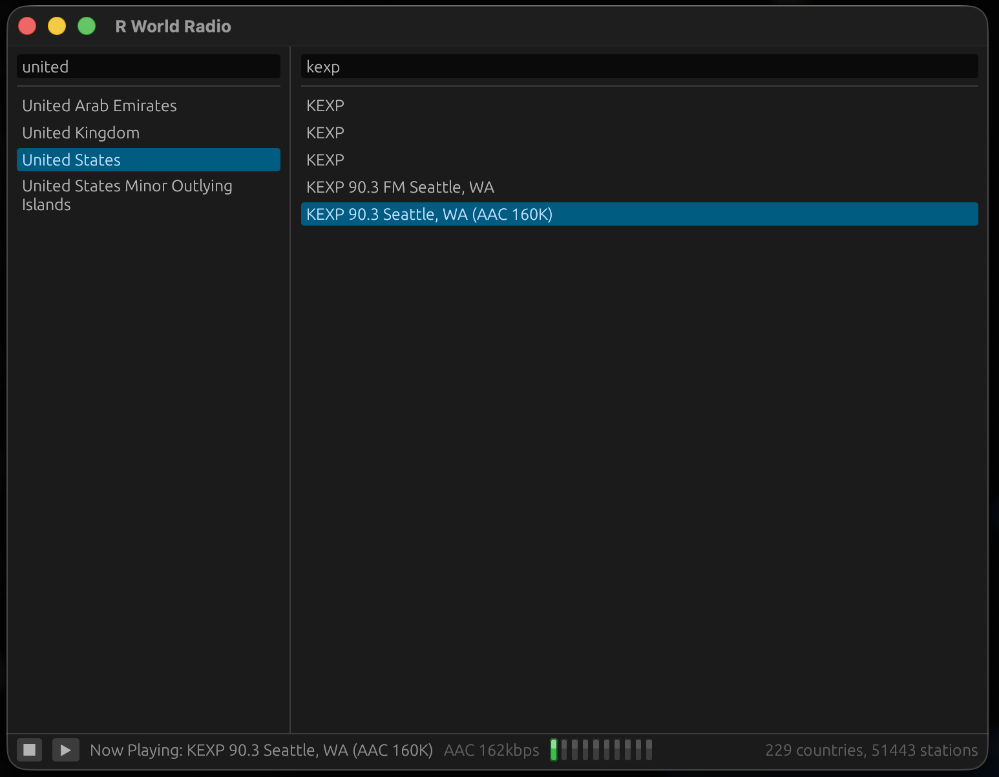

# R World Radio - macOS 포팅 (Rust)

[English README](README.md)

macOS용 인터넷 라디오 플레이어로, Haiku/BeAPI 원본을 포팅한 것입니다(원본과 Linux
포팅은 [`rworldradio-linux`](https://github.com/rainygirl/rworldradio-linux)
저장소 참고). 미리 만들어져 함께 배포되는 방송국 데이터셋(`data/`)을 읽어 국가별로
묶어 보여주고, 방송국을 더블클릭하면 프로세스 안에서 바로 재생합니다. 외부 플레이어
프로세스도 없고, 실제 오디오 스트리밍 외에는 어떤 네트워크 접근도 하지 않습니다.



## 이 저장소가 얇은 이유

이런 포팅에서 실제로 플랫폼에 종속되는 부분은 거의 없습니다. 데이터셋 파서,
HTTP/TLS, HLS 파이프라인, MPEG-TS 디먹서, ADTS 정규화, symphonia 디코딩, cpal 출력
경로, 그리고 egui UI 전체가 Linux 포팅과 공유되며, 이 저장소가 단독으로 빌드되도록
[`core/`](core/VENDORED.md)에 벤더링되어 있습니다. cpal이 ALSA 대신 CoreAudio를
알아서 선택하므로 오디오 쪽은 여기에 코드가 전혀 필요하지 않았습니다.

실제로 다른 부분, 즉 이 크레이트에 있는 전부는 다음과 같습니다:

| 파일 | macOS에 종속된 내용 |
|---|---|
| `src/paths.rs` | 데이터셋 탐색 순서: XDG의 `~/.local/share`와 `/usr/share` 대신 `.app` 번들의 `Contents/Resources`, 그다음 `~/Library/Application Support/RWorldRadio`. |
| `src/fonts.rs` | Hiragino / Apple SD Gothic Neo / PingFang / Arial Unicode를 문자 체계별로 계층 구성. macOS에는 질의할 fontconfig가 없고 CJK 전체를 커버하는 단일 폰트도 없습니다. |
| `src/mediakeys.rs` | F8 재생/정지 키. 이 키는 키 이벤트로 창에 전달되지 않고, macOS가 MediaPlayer의 `MPRemoteCommandCenter`를 통해 가장 최근에 Now Playing 상태를 발행한 앱으로 보냅니다. |
| `src/main.rs` | Cmd+Q와 Cmd+W. winit은 `NSMenu`를 만들지 않으므로, 이게 없으면 표준 종료 단축키가 아무 동작도 하지 않습니다. |
| `packaging/`, `install.sh` | `.desktop` 파일과 hicolor PNG 대신 `.app` 번들, `Info.plist`, `.icns`. |

그 외 모든 것은 `core/`에 있으며, Linux 포팅 크레이트를 그대로 복사한 것입니다.
재동기화 방법과 그중 이 저장소가 쓰지 않는 부분은
[`core/VENDORED.md`](core/VENDORED.md)를 참고하세요.

이 분리는 의도적입니다. macOS 종속 영역을 작은 파일 네 개로 억제해 줍니다. 벤더링의
트레이드오프는 `core/`의 수정이 자동으로 반영되지 않고, Linux 저장소에서 고친 뒤 다시
복사해 와야 한다는 점입니다.

## 요구사항

- macOS 10.15 이상 (Apple silicon 또는 Intel).
- Rust 1.88 이상 - [rustup](https://rustup.rs)으로 설치.
- Xcode 커맨드 라인 도구(`cc`와 링커용): `xcode-select --install`.

그 외 의존성은 없습니다. CoreAudio, Metal/OpenGL, 시스템 폰트는 모두 macOS의
일부입니다.

## 빌드 및 실행

```
cargo run --release          # 이 디렉터리에서
```

`data/`는 런타임에 다음 순서로 찾습니다: 감싸고 있는 `.app` 번들의
`Contents/Resources/data`, 그다음 바이너리 옆과 그 위 3단계까지(`cargo run`과
`target/release/`를 커버), 그다음 `~/Library/Application Support/RWorldRadio/data`,
`/Library/Application Support/RWorldRadio/data`, 마지막으로 `../data`와 `data`
(마지막 항목이 이 디렉터리에서 `cargo run`을 할 때 쓰이는 경로). 어느 것이 쓰였는지는
상태 바에 마우스를 올려 확인할 수 있습니다.

radio-browser에서 데이터셋을 갱신하려면:

```
python3 tools/update_stations_db.py
```

## 설치

```
./install.sh                 # 빌드 + ~/Applications에 설치 (sudo 불필요)
./install.sh --system        # /Applications에 설치
./install.sh --build-only    # build/RWorldRadio.app만 조립
./install.sh --universal     # arm64 + x86_64 유니버설 바이너리
./install.sh --uninstall
```

번들은 자체 완결적입니다. 데이터셋이 `Contents/Resources/data`로 복사되므로 설치된
앱은 이 체크아웃이 남아 있는지에 의존하지 않고, 휴지통으로 끌어다 놓으면 모두
제거됩니다. 이것이 macOS의 관례이며, Linux 포팅의 XDG 분리보다 단순합니다.

`install.sh`는 번들에 ad-hoc 서명(`codesign --sign -`)을 합니다. Apple silicon에서는
서명되지 않은 바이너리가 아예 실행되지 않으므로 필수이며, `lipo` 및 번들로의 복사는
링커가 넣은 서명을 무효화합니다.

앱 아이콘은 `packaging/rworldradio.icns`에 있고, 번들 밖에서 실행할 때(`cargo run`)
Dock에 표시되도록 바이너리에도 컴파일되어 들어갑니다. 이게 없으면 macOS는 일반
"exec" 아이콘으로 대체합니다. 둘 다 아이콘을 코드로 그리는
`core/packaging/make-icons.py`에서 나옵니다:

```
cd core/packaging && python3 make-icons.py --icns ../../packaging/rworldradio.icns
```

## 사용법

- 두 검색창 중 아무 곳에나 입력하면 필터링됩니다. 국가를 클릭하고 방송국을
  더블클릭하면 재생됩니다(또는 선택 후 ▶ 누르기).
- ■ 버튼은 재생 중일 때만 나타납니다.
- LED 바는 실제로 재생되고 있는 오디오의 피크 레벨입니다.
- 방송국에 마우스를 올리면 코덱, 비트레이트, 언어, 좌표, 스트림 URL이 보입니다.
- F8(재생/정지 미디어 키)로 재생을 토글합니다. 제어 센터와 헤드폰의 재생 컨트롤도
  같습니다. 선택된 방송국이 없으면 아무 동작도 하지 않습니다 - 5만 개가 넘는
  목록에서 기본으로 삼을 만한 방송국이 없기 때문입니다.
- Cmd+Q 또는 Cmd+W로 종료합니다.

## 스트림 지원 범위와 한계

같은 코드이므로 Linux 포팅과 동일합니다. 프로그레시브 icecast/shoutcast(MP3, AAC,
Ogg/Vorbis, FLAC)와 HLS를 지원하며, MPEG-TS와 packed-audio 세그먼트 모두, 그리고
리다이렉트와 `.m3u`/`.pls` 간접 참조도 실제로 오디오를 제공하는 지점까지 따라갑니다.

지원하지 않는 것: **HE-AAC / AAC+**는 재생되지만 코어 레이어만 디코딩되어 소리가 더
탁하고 명목 샘플레이트의 절반으로 동작합니다. **Opus**는 재생되지 않습니다
(Ogg/Vorbis는 됩니다). **암호화된 HLS(`#EXT-X-KEY`)와 fragmented MP4/CMAF
세그먼트**는 재생되지 않습니다.

## 테스트

```
cargo test                  # 이 크레이트: 데이터셋 경로와 폰트 탐색
cd core && cargo test       # 공유 구현
```

`src/paths.rs` 테스트는 macOS 탐색 순서와 체크아웃의 데이터셋이 실제로 발견되는지를
검증합니다. `src/fonts.rs` 테스트는 하드코딩된 폰트 경로 중 최소 하나가 머신에
존재하고 로드되는지를 검증합니다. 향후 macOS가 그 파일들을 옮기면, 앱이 조용히 CJK
렌더링을 잃는 대신 이 테스트에서 드러납니다.

## 재생되지 않는 방송국 진단

진단 도구 두 개는 공유 크레이트에 있습니다:

```
cd core
cargo run --example probe_stream -- "BBC Radio 4" 5    # 디코딩만, 오디오 디바이스 없음
cargo run --example play_stream  -- "BBC Radio 4" 8    # 디코딩 후 CoreAudio로 재생
```

`probe_stream`은 되는데 `play_stream`이 안 되면 문제는 스트림이 아니라 오디오
출력입니다.

## 검증 상태

macOS 15(Apple silicon, arm64)에서 빌드 및 실행:

- `cargo build --release` 클린, `cargo test`가 여기와 공유 크레이트에서 통과.
- `.app` 번들이 조립되고, Info.plist에서 `plutil -lint` 통과, `codesign -dv`가 유효한
  ad-hoc 서명을 보고하며, macOS가 번들의 라디오 아이콘을 해석함
  (`NSWorkspace.iconForFile`로 질의).
- 앱이 번들에서 실행되어 229개 국가 / 51,443개 방송국을 모두 로드하고, 레벨 미터가
  따라 움직이는 상태로 방송국 하나를 CoreAudio로 끝까지 재생함(TBS eFM 101.3, AAC
  414kbps). 일본어와 한국어 방송국 이름이 렌더링됨.
- `play_stream`으로 두 스트림 경로를 CoreAudio에서 검증: 프로그레시브 MP3
  방송국(피크 0.228)과 HLS/packed-ADTS-AAC 방송국(피크 0.439).
- 설치된 번들에서 F8 미디어 키로 선택한 방송국의 재생과 정지가 동작함.

검증되지 않은 것: Intel(x86_64) macOS와 `--universal` 빌드. 아키텍처에 종속된 코드는
없지만, 둘 다 실행해 보지는 않았습니다.

## 라이선스

MIT - [LICENSE](LICENSE) 참고.

## AI 고지

이 애플리케이션은 Claude와 함께 만들었습니다.
