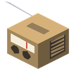
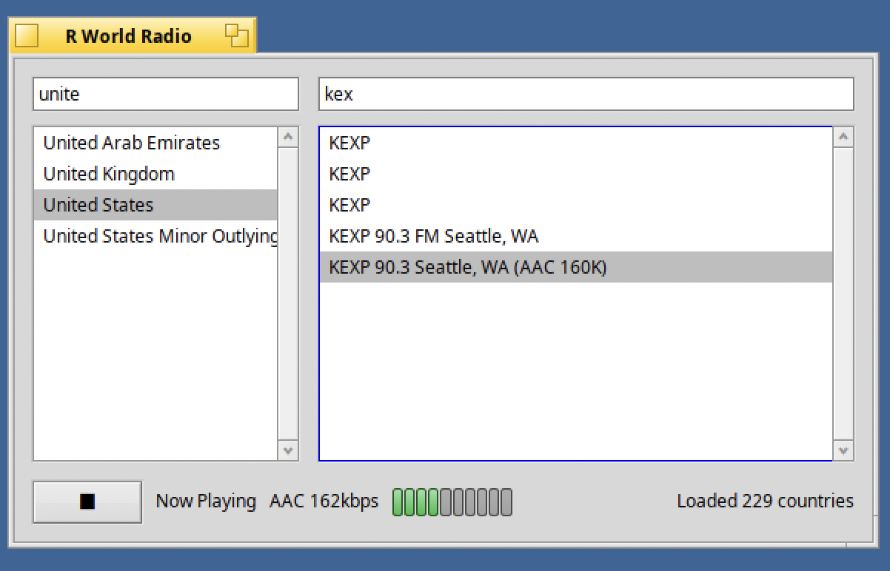
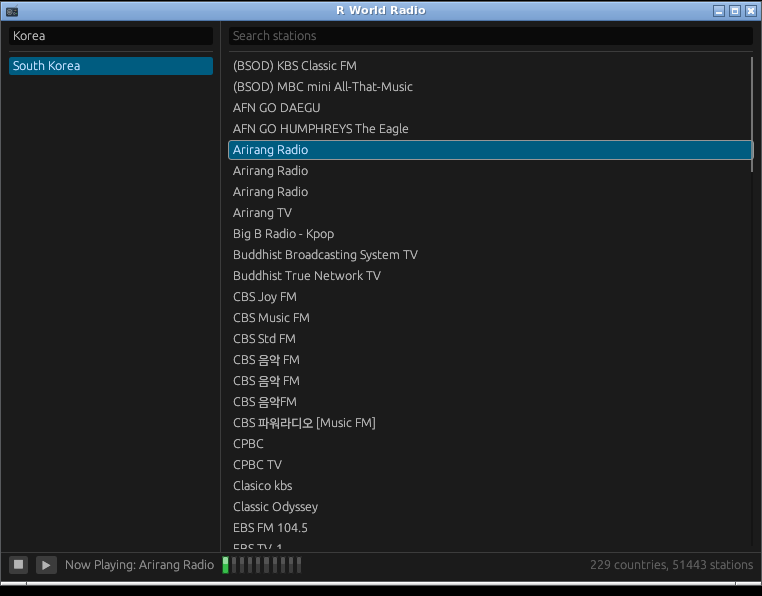
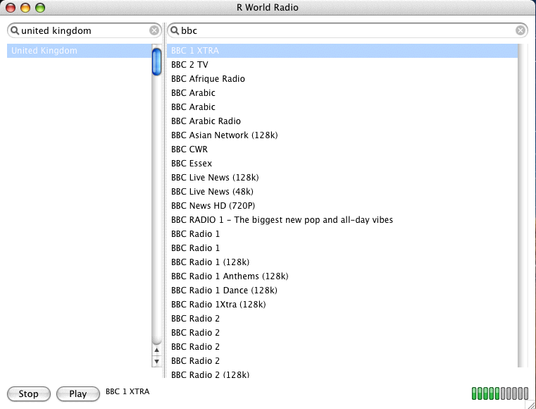
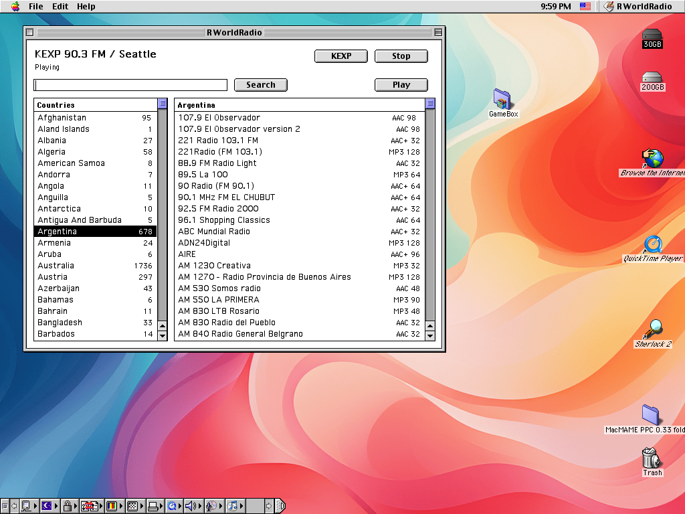
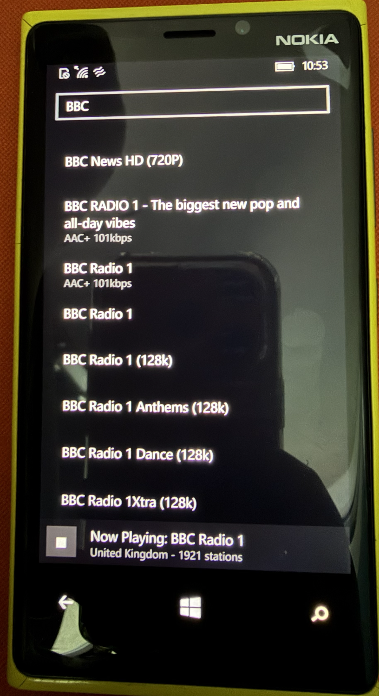

#  R World Radio

Internet radio player. Pick a country, pick a station, it plays - about 51,000
stations across 229 countries, from a station list that ships with the app.
Nothing is contacted over the network except the station you chose to listen to.

English · [한국어](README.ko.md)

One repository, six ports. Each port is a directory with its own install guide;
the station list and the code the Rust ports share live in [`shared/`](shared).

| Port | Platform | Install guide |
|---|---|---|
| [`renkuos/`](renkuos) | RenkuOS (HaikuOS): x86_gcc2, x86_64, arm64 | [renkuos/README.md](renkuos/README.md) - `pkgman install rworldradio` |
| [`linux/`](linux) | Linux desktops (X11 / XWayland) | [linux/README.md](linux/README.md) |
| [`mac/`](mac) | macOS 10.15 or newer, Apple silicon and Intel | [mac/README.md](mac/README.md) |
| [`macppc/`](macppc) | Mac OS X 10.4 Tiger on a PowerPC G4 | [macppc/README.md](macppc/README.md) |
| [`os9/`](os9) | Mac OS 9 on PowerPC, with a relay on a Linux box | [os9/README.md](os9/README.md) - prebuilt app in `os9/dist/` |
| [`winphone/`](winphone) | Windows 10 Mobile (Windows Phone 10) | [winphone/README.md](winphone/README.md) |

## Screenshots

### RenkuOS (HaikuOS)



### Linux



### macOS


### Mac OS X 10.4 (PowerPC)



### Mac OS 9



### Windows 10 Mobile



## Layout

```
shared/data/     the station list: countries.json + countries/<slug>.json (radio-browser)
shared/core/     the Rust crate the Linux and macOS ports are built on
shared/tools/    update_stations_db.py - refreshes shared/data from radio-browser
renkuos/ linux/ mac/ macppc/ os9/ winphone/   one directory per port
```

How the ports relate, how to change them and everything that is not an install
step is in [AGENTS.md](AGENTS.md) and in each port's own `AGENTS.md`.

## Station list source

- [radio-browser](https://www.radio-browser.info/)

## License

MIT - see [LICENSE](LICENSE). The PowerPC and arm64 builds link third-party
decoders with their own terms; see [macppc/README.md](macppc/README.md#licence)
and [renkuos/THIRD-PARTY-NOTICES.md](renkuos/THIRD-PARTY-NOTICES.md).

## AI disclosure

Claude was used in the development of this program.
