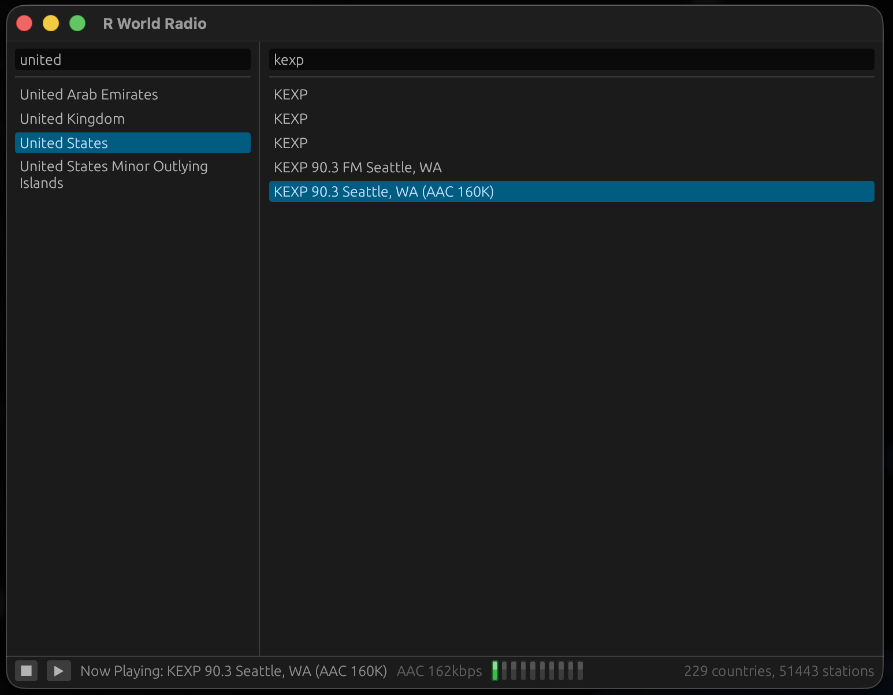

# R World Radio - Mac OS X 10.4 PowerPC port (C / Carbon)

[한국어 README](README.ko.md)

Internet radio player for a PowerPC Mac running Tiger. 



## Requirements

| | |
|---|---|
| Machine | an iMac G4, or any PowerPC 745x G4 |
| System | Mac OS X 10.4 |
| RAM | 256 MB (the app's resident set is about 25 MB) |
| Toolchain | Xcode 2.5 - GCC 4.0.1 and the 10.4u SDK |
| Also | a network connection |

The build targets `-mcpu=7450`, so it will not run on a G3, and it has no Intel
slice.

## Two-machine build

Tiger cannot prepare its own build inputs. Its `curl` cannot reach a modern TLS
host, so nothing downloads; and it ships Python 2.3, so none of the generator
scripts here run. Everything generated is therefore built on a current Mac and
copied across, and only the compile happens on the PowerPC machine.

Cloning this repository is also not enough on its own - three build inputs are
generated rather than checked in:

| | where it comes from |
|---|---|
| `vendor/` sources | `tools/fetch-vendor.sh` downloads mbedTLS, libmad and faad2 |
| `data/cacert.der` | `make castore`, from any PEM CA bundle on the build machine |
| `data/stations.dat` | `make dataset`, from the station JSON already in `data/` |

### 1. On a modern Mac

```sh
tools/fetch-vendor.sh    # downloads mbedTLS, libmad and faad2 into vendor/
make castore             # data/cacert.der, from the host's CA bundle
make dataset             # data/countries*.json -> data/stations.dat
make icons               # packaging/rworldradio.icns and packaging/icon_png.h
```

`make dataset` needs no arguments - the station JSON is checked in. Pass
`DATASET_SRC=<dir>` to build it from another port's `data/` directory instead.

Then copy the whole checkout across to the Tiger machine, including `data/`,
`packaging/*.icns`, `packaging/icon_png.h` and the tarballs in `vendor/`.

### 2. On the Tiger machine

```sh
tools/fetch-vendor.sh    # unpacks the tarballs already there - no network needed
make                     # -> build/rworldradio
make bundle              # -> build/RWorldRadio.app
```

`tools/fetch-vendor.sh` skips any tarball that is already present, so here it
only unpacks and writes the two vendor `config.h` files.

## Installing

```sh
./install.sh             # into /Applications
./install.sh --user      # into ~/Applications
./install.sh --prefix DIR
```

The bundle is self-contained - the station dataset and the CA store live inside
it under `Contents/Resources` - so uninstalling leaves nothing behind:

```sh
./install.sh --uninstall
```

or just drag `RWorldRadio.app` to the Trash.

`build/rworldradio` also runs directly out of the build tree, without a bundle,
and finds `data/` beside itself.

## Checking the build without a G4

```sh
make check               # 162 checks, host compiler
make check-sanitize      # the same, under ASan, UBSan and TSan
```

builds the protocol and data half of the port with the *host* compiler and runs
its tests against the real `data/stations.dat` and `data/cacert.der` this build
ships. Carbon, CoreAudio and the two decoders are not covered.

To run that same half on real big-endian PowerPC, under an emulated Power Mac
with a 7450:

```sh
brew install qemu llvm lld
tools/ppc-verify/verify.sh
```

See [`tools/ppc-verify/README.md`](tools/ppc-verify/README.md).

## Known limitations

- **Ogg, Opus, FLAC, MP4/M4A and WAV do not play.** That is 505 of the 51,443
  stations, under 1%; the status row names the format rather than failing
  silently.
- **No TLS 1.3.** A small minority of HTTPS hosts require it and will report a
  handshake failure.
- **No media keys and no now-playing metadata.**
- **PowerPC G4 only** - not G3, not Intel.

## Licence

The source here is **MIT** - see [`LICENSE`](LICENSE). It covers `src/`,
`tests/`, `tools/` and `packaging/`, and can be reused under those terms on its
own.

The **built binary is GPL-2.0-or-later**, because it statically links libmad and
faad2 (both GPL-2.0-or-later) and mbedTLS (dual Apache-2.0 / GPL-2.0-or-later,
taken here under the GPL arm). Distributing binaries carries the usual GPL
obligation to offer the corresponding source for those three as well. See
[`vendor/README.md`](vendor/README.md), which also notes faad2's AAC patent
clause.

