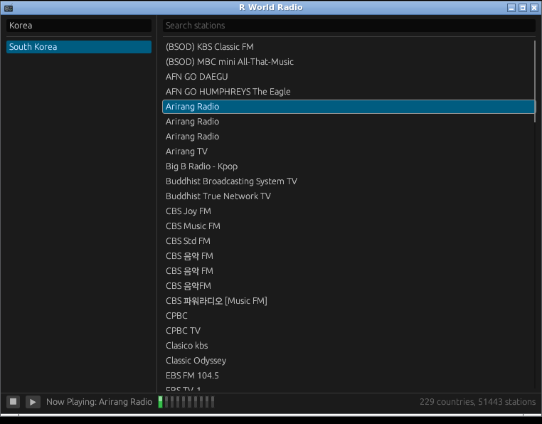

# R World Radio for Linux

[English](README.md) · 한국어



Linux 데스크톱(X11 또는 XWayland)용 인터넷 라디오 플레이어입니다. Linux Mint
XFCE(x86_64)에서 빌드하고 테스트했습니다.

## 요구 사항

- **Rust 1.88 이상.** Mint/Debian이 패키징한 `rustc`는 너무 오래되었으므로
  [rustup](https://rustup.rs)으로 설치합니다.

  ```
  curl --proto '=https' --tlsv1.2 -sSf https://sh.rustup.rs | sh
  ```

- 빌드 패키지:

  ```
  sudo apt install build-essential pkg-config libasound2-dev
  ```

- OpenGL이 되는 X11 또는 XWayland 세션. Mint XFCE에는 이미 있습니다.
- 일본어, 중국어, 한국어 방송국 이름이 네모가 아니라 글자로 보이게 하려면:
  `sudo apt install fonts-noto-cjk`

## 설치

이 디렉터리에서:

```
./install.sh              # 빌드 후 사용자 계정에 설치 - root 불필요
./install.sh --system     # /usr/local에 설치, root 필요
./install.sh --uninstall  # --system으로 설치했다면 --system도 같이
```

로그아웃이나 재부팅 없이 응용 프로그램 메뉴의 **멀티미디어**에 나타납니다.

사용자 계정 설치는 다음 위치에 씁니다.

```
~/.local/bin/rworldradio
~/.local/share/rworldradio/data/                  방송국 목록
~/.local/share/applications/rworldradio.desktop
~/.local/share/icons/hicolor/<size>/apps/rworldradio.png
```

방송국 목록은 링크가 아니라 복사하므로 이 체크아웃을 옮기거나 지워도 설치된 앱은
그대로 동작합니다. `--uninstall`은 위 항목을 모두 지웁니다.

`~/.local/bin`이 `PATH`에 없어도 메뉴 항목은 절대 경로를 쓰므로 동작하지만, 셸에서
`rworldradio` 명령은 안 됩니다. 필요하면 추가하세요.

```
export PATH="$HOME/.local/bin:$PATH"
```

## 설치하지 않고 실행

```
cargo run --release
```

방송국 목록은 `../shared/data`에서 찾습니다.

## 방송국 목록 최신 상태로 유지하기

```
python3 ../shared/tools/update_stations_db.py
```

radio-browser의 카탈로그를 받아 `shared/data`를 다시 씁니다. 인터넷 연결이
필요합니다. 그 뒤 `./install.sh`를 다시 실행해 갱신된 목록을 복사하세요. 앱
자체는 이 작업을 하지 않고 함께 배포된 목록만 읽습니다.

## 라이선스

MIT. [LICENSE](LICENSE)를 참고하세요.

## AI 사용 고지

이 프로그램 개발에는 Claude가 활용되었습니다.
