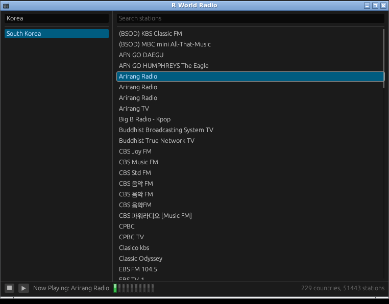

# R World Radio for Linux

English · [한국어](README.ko.md)



Internet radio player for Linux desktops (X11 or XWayland). Built and tested on
Linux Mint XFCE (x86_64).

## Requirements

- **Rust 1.88 or newer.** Mint/Debian's packaged `rustc` is too old, so install it
  through [rustup](https://rustup.rs):

  ```
  curl --proto '=https' --tlsv1.2 -sSf https://sh.rustup.rs | sh
  ```

- Build packages:

  ```
  sudo apt install build-essential pkg-config libasound2-dev
  ```

- An X11 or XWayland session with OpenGL, which any Mint XFCE install already has.
- For Japanese, Chinese and Korean station names to show as text rather than
  boxes: `sudo apt install fonts-noto-cjk`

## Installing

From this directory:

```
./install.sh              # builds, then installs per-user - no root needed
./install.sh --system     # /usr/local, needs root
./install.sh --uninstall  # add --system if that is how it was installed
```

It appears in the applications menu under **Multimedia**, with no logout or reboot
needed.

A per-user install writes to:

```
~/.local/bin/rworldradio
~/.local/share/rworldradio/data/                  the station list
~/.local/share/applications/rworldradio.desktop
~/.local/share/icons/hicolor/<size>/apps/rworldradio.png
```

The station list is copied rather than linked, so the installed app keeps working
if this checkout is moved or deleted. `--uninstall` removes all of the above.

If `~/.local/bin` is not on your `PATH`, the menu entry still works - it uses an
absolute path - but the `rworldradio` command from a shell will not. Add it with:

```
export PATH="$HOME/.local/bin:$PATH"
```

## Running without installing

```
cargo run --release
```

The station list is found in `../shared/data`.

## Keeping the station list current

```
python3 ../shared/tools/update_stations_db.py
```

Fetches radio-browser's catalogue and rewrites `shared/data`. Needs internet
access. Re-run `./install.sh` afterwards to copy the refreshed list into place.
The app itself never does this - it only reads the list that shipped with it.

## License

MIT - see [LICENSE](LICENSE).

## AI disclosure

Claude was used in the development of this program.
