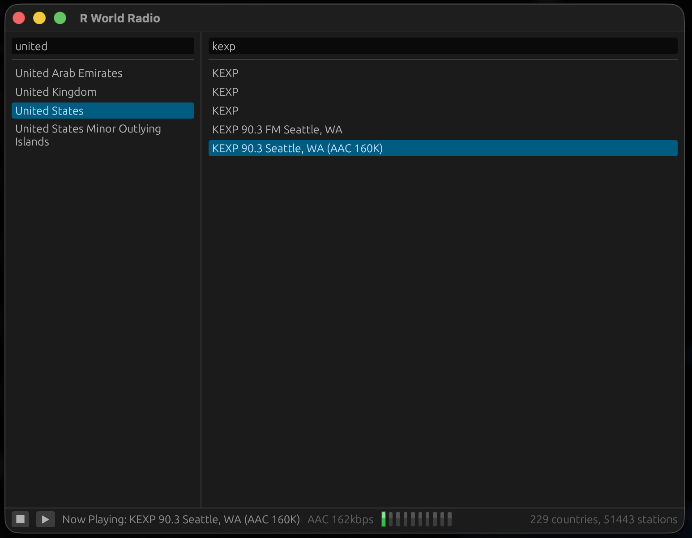

# R World Radio for macOS

[English](README.md) · 한국어



macOS 10.15 이상, Apple silicon과 Intel용 인터넷 라디오 플레이어입니다.

## 요구 사항

- Rust 1.88 이상. [rustup](https://rustup.rs)으로 설치합니다.
- `cc`와 링커를 위한 Xcode 명령줄 도구: `xcode-select --install`

그 외 의존성은 없습니다. CoreAudio, Metal/OpenGL, 시스템 글꼴은 모두 macOS에
들어 있습니다.

## 설치

이 디렉터리에서:

```
./install.sh                 # 빌드 후 ~/Applications에 설치 (sudo 불필요)
./install.sh --system        # /Applications에 설치
./install.sh --build-only    # build/RWorldRadio.app만 만들기
./install.sh --universal     # arm64 + x86_64 유니버설 바이너리
./install.sh --uninstall
```

번들은 자체 완결적입니다. 방송국 목록이 `Contents/Resources/data`에 복사되므로
설치된 앱은 이 체크아웃이 남아 있지 않아도 동작하고, 휴지통에 끌어다 놓으면
전부 지워집니다.

번들은 Apple Developer ID가 아니라 ad-hoc 서명이라 처음 열 때 macOS가 한 번 물을
수 있습니다. **시스템 설정 > 개인정보 보호 및 보안**에서 허용하거나 터미널에서:

```sh
/usr/bin/xattr -dr com.apple.quarantine ~/Applications/RWorldRadio.app
```

## 설치하지 않고 실행

```
cargo run --release
```

방송국 목록은 `../shared/data`에서 찾습니다.

## 방송국 목록 최신 상태로 유지하기

```
python3 ../shared/tools/update_stations_db.py
```

그 뒤 `./install.sh`를 다시 실행해 갱신된 목록을 번들에 복사하세요.

## 라이선스

MIT. [LICENSE](LICENSE)를 참고하세요.

## AI 사용 고지

이 프로그램 개발에는 Claude가 활용되었습니다.
