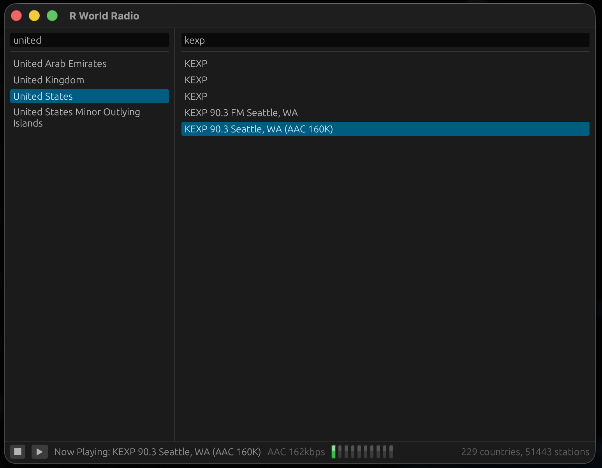

# R World Radio for macOS

English · [한국어](README.ko.md)



Internet radio player for macOS 10.15 or newer, Apple silicon or Intel.

## Requirements

- Rust 1.88 or newer - install via [rustup](https://rustup.rs).
- Xcode command line tools, for `cc` and the linker: `xcode-select --install`.

No other dependencies. CoreAudio, Metal/OpenGL and the system fonts are all part
of macOS.

## Installing

From this directory:

```
./install.sh                 # build + install into ~/Applications (no sudo)
./install.sh --system        # install into /Applications
./install.sh --build-only    # just assemble build/RWorldRadio.app
./install.sh --universal     # arm64 + x86_64 universal binary
./install.sh --uninstall
```

The bundle is self-contained - the station list is copied into
`Contents/Resources/data`, so the installed app doesn't depend on this checkout
still existing, and dragging it to the Trash removes everything.

The bundle is ad-hoc signed, not signed with an Apple Developer ID, so macOS may
ask once before opening it. Allow it in **System Settings > Privacy & Security**,
or from Terminal:

```sh
/usr/bin/xattr -dr com.apple.quarantine ~/Applications/RWorldRadio.app
```

## Running without installing

```
cargo run --release
```

The station list is found in `../shared/data`.

## Keeping the station list current

```
python3 ../shared/tools/update_stations_db.py
```

Then re-run `./install.sh` to copy the refreshed list into the bundle.

## License

MIT - see [LICENSE](LICENSE).

## AI disclosure

Claude was used in the development of this program.
