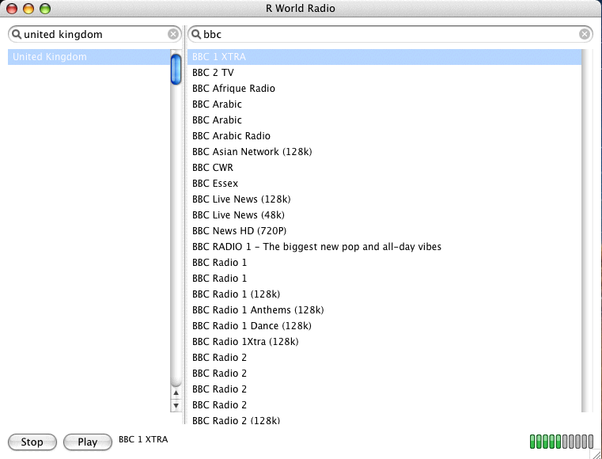

# R World Radio for Mac OS X 10.4 (PowerPC)

[English](README.md) · 한국어



Tiger가 설치된 PowerPC Mac용 인터넷 라디오 플레이어입니다. Carbon과 CoreAudio를
쓰는 C 코드이고, TLS 스택과 디코더를 함께 묶어 빌드합니다.

## 요구 사항

| | |
|---|---|
| 기기 | iMac G4 또는 PowerPC 745x G4 |
| 시스템 | Mac OS X 10.4 |
| RAM | 256 MB (앱의 상주 메모리는 약 25 MB) |
| 툴체인 | Xcode 2.5 - GCC 4.0.1과 10.4u SDK |
| 그 외 | 네트워크 연결 |

`-mcpu=7450`으로 빌드하므로 G3에서는 실행되지 않고, Intel 슬라이스도 없습니다.

## 머신 두 대로 빌드

Tiger는 빌드 입력을 스스로 준비하지 못합니다. Tiger의 `curl`은 요즘 TLS 호스트에
접속하지 못해 아무것도 내려받지 못하고, Python이 2.3이라 생성 스크립트도 돌지
않습니다. 그래서 생성물은 모두 최신 Mac에서 만들어 복사하고, PowerPC 머신에서는
컴파일만 합니다.

저장소를 복제하는 것만으로는 부족합니다. 빌드 입력 셋은 커밋되어 있지 않고
생성합니다.

| | 어디서 오는가 |
|---|---|
| `vendor/` 소스 | `tools/fetch-vendor.sh`가 mbedTLS, libmad, faad2를 내려받습니다 |
| `data/cacert.der` | `make castore`, 빌드 머신의 PEM CA 번들에서 |
| `data/stations.dat` | `make dataset`, `../shared/data`의 방송국 목록에서 |

### 1. 최신 Mac에서

이 디렉터리에서:

```sh
tools/fetch-vendor.sh    # mbedTLS, libmad, faad2를 vendor/에 내려받기
make castore             # 호스트의 CA 번들로 data/cacert.der 생성
make dataset             # ../shared/data -> data/stations.dat
make icons               # packaging/rworldradio.icns와 packaging/icon_png.h
```

그 뒤 이 디렉터리를 `data/`, `packaging/*.icns`, `packaging/icon_png.h`,
`vendor/`의 tarball까지 포함해 Tiger 머신으로 복사합니다. (`../shared/data`는
이미 `data/stations.dat`에 들어 있어 필요 없습니다.)

### 2. Tiger 머신에서

```sh
tools/fetch-vendor.sh    # 이미 있는 tarball을 풀기만 함 - 네트워크 불필요
make                     # -> build/rworldradio
make bundle              # -> build/RWorldRadio.app
```

`tools/fetch-vendor.sh`는 이미 있는 tarball은 건너뛰므로 여기서는 압축을 풀고
vendor의 `config.h` 두 개만 씁니다.

## 설치

```sh
./install.sh             # /Applications에
./install.sh --user      # ~/Applications에
./install.sh --prefix DIR
```

번들은 자체 완결적입니다. 방송국 목록과 CA 저장소가 `Contents/Resources` 안에
있으므로 제거해도 남는 것이 없습니다.

```sh
./install.sh --uninstall
```

또는 `RWorldRadio.app`을 휴지통에 끌어다 놓으면 됩니다.

`build/rworldradio`는 번들 없이 빌드 트리에서 바로 실행되며 옆의 `data/`를
찾습니다.

## 라이선스

여기 있는 소스는 **MIT**입니다. [`LICENSE`](LICENSE)를 참고하세요. `src/`,
`tests/`, `tools/`, `packaging/`에 적용되며 이 조건으로 따로 재사용할 수
있습니다.

**빌드된 바이너리는 GPL-2.0-or-later**입니다. libmad와 faad2(둘 다
GPL-2.0-or-later), 그리고 mbedTLS(Apache-2.0 / GPL-2.0-or-later 이중 라이선스,
여기서는 GPL 쪽)를 정적으로 링크하기 때문입니다. 바이너리를 배포하면 이 셋의
소스도 제공해야 하는 통상의 GPL 의무가 따릅니다. faad2의 AAC 특허 조항도 적어 둔
[`vendor/README.md`](vendor/README.md)를 참고하세요.

## AI 사용 고지

이 프로그램 개발에는 Claude가 활용되었습니다.
