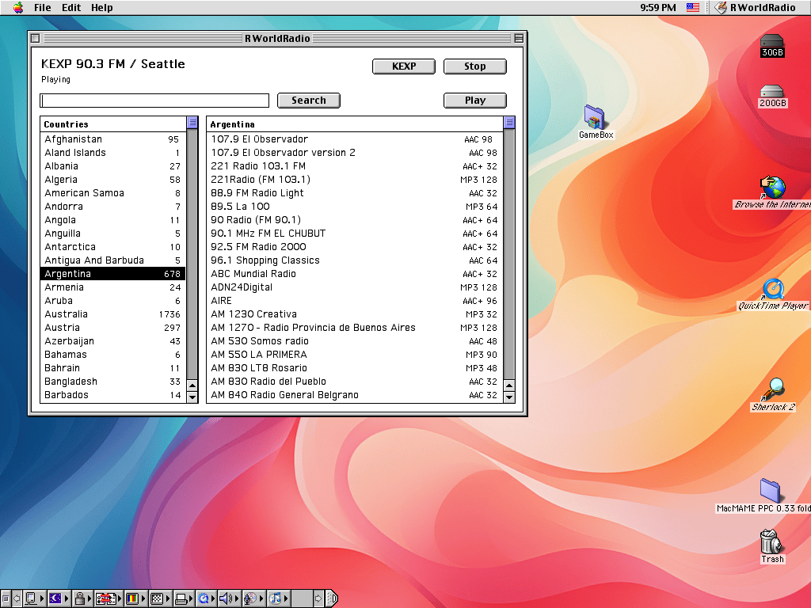

# R World Radio for Mac OS 9

English · [한국어](README.ko.md)



Internet radio for Mac OS 9 (PowerPC). It is two parts: a classic Toolbox app on
the Mac, and a small relay on a Linux machine on the same network that fetches
and transcodes the stations for it (Mac OS 9 has no modern TLS, AAC or HLS).

## 1. The relay (Linux, e.g. a Raspberry Pi)

Needs Python 3 and ffmpeg with libmp3lame. From this directory:

```sh
python3 relay/radio_relay.py --port 8083        # reads ../shared/data
```

To keep it running as a service:

```sh
sudo cp relay/radio-relay.service /etc/systemd/system/
sudo systemctl enable --now radio-relay
```

The service file assumes the checkout is at
`/home/rainygirl/Workspace/robot/tiger/radio`; adjust `WorkingDirectory` and
`ExecStart` to where this directory actually is.

## 2. The Mac app

Requirements: Mac OS 9 with QuickTime 6, URL Access and Open Transport; a 24 MB
memory partition (12 MB minimum).

A prebuilt app is in [`dist/RWorldRadio.bin`](dist/RWorldRadio.bin) (MacBinary,
built from the `mac/` sources here). Copy it to the Mac and expand it with
StuffIt Expander (or any MacBinary tool that keeps the resource fork); the
result is the `RWorldRadio` application.

To build it yourself instead, on any machine with Docker (Retro68 runs in a
container):

```sh
make            # -> build/mac/RWorldRadio.bin (MacBinary)
```

Next to the app, create a text file `R WorldRadio Settings` (CR line endings)
with the relay's address:

```
relay=10.0.0.129:8083
last=kexp            (or a station id; empty = play nothing at launch)
lastname=KEXP 90.3 FM / Seattle
```

The app writes this file itself afterwards.

## License

MIT, see [LICENSE](LICENSE).

## AI disclosure

Claude was used in the development of this program.
