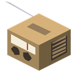
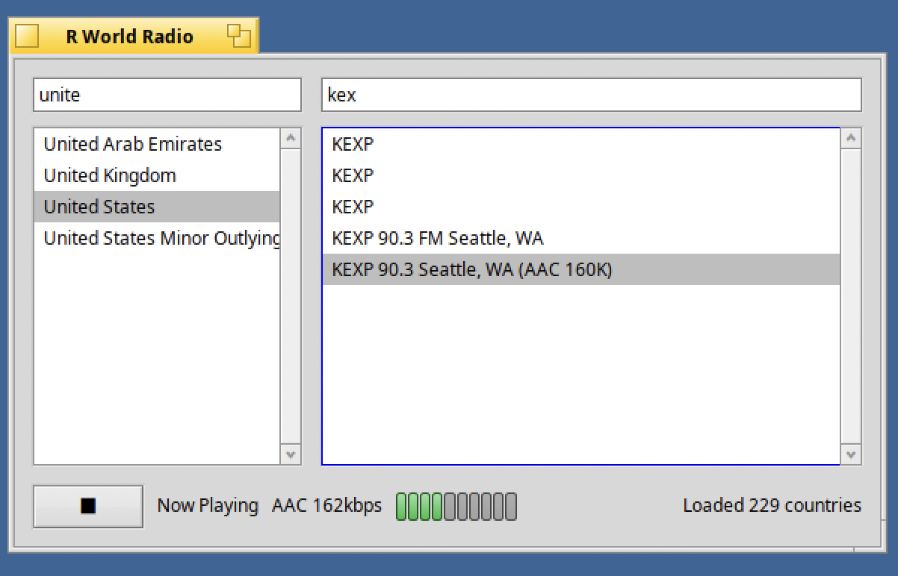

#  R World Radio for RenkuOS (HaikuOS)

[English](README.md) · 한국어



RenkuOS (HaikuOS) 네이티브 인터넷 라디오 플레이어입니다. x86_gcc2, x86_64,
arm64를 지원합니다.

## pkgman으로 설치

저장소를 한 번 추가한 뒤 설치합니다.

```sh
pkgman add-repo https://pkgman.rainygirl.com/$(getarch -p)
pkgman install rworldradio
```

32비트 x86_gcc2 이미지에서는 앱이 x86 보조 툴체인으로 빌드되므로 패키지 이름이
`rworldradio_x86`입니다.

```sh
pkgman install rworldradio_x86
```

Deskbar의 **Applications** 메뉴에 **RWorldRadio**로 나타납니다.

`pkgman add-repo`가 `Operation not supported`로 실패하면 그 이미지의 네트워크
킷에 TLS가 없는 것입니다. `https://` 대신 `http://`를 쓰세요.

## 소스에서 빌드

Haiku에서, 표준 설치에 `/boot/system/develop/` 아래로 들어 있는 SDK로:

```sh
make                 # -> objects.<arch>-<compiler>-release/rworldradio
./install.sh         # 빌드 후 Deskbar의 Applications 메뉴에 연결
```

`install.sh`는 방송국 목록을 `../shared/data`에서 링크하므로 이 체크아웃을
그 자리에 두세요. 처음 설치할 때는 메뉴 항목이 보이기 전에 재부팅이 필요할 수
있습니다.

arm64 네이티브 빌드에는 makefile-engine이 없으므로 `./build-arm64.sh`를 씁니다.

## 방송국 목록 최신 상태로 유지하기

```sh
python3 ../shared/tools/update_stations_db.py
```

인터넷이 되는 머신에서 실행하세요. 앱 자체는 이 작업을 하지 않습니다.

## 라이선스

MIT. [LICENSE](LICENSE)를 참고하세요. arm64 빌드에는 minimp3와 FDK-AAC가 들어
있습니다. [THIRD-PARTY-NOTICES.md](THIRD-PARTY-NOTICES.md)를 참고하세요.

## AI 사용 고지

이 프로그램 개발에는 Claude가 활용되었습니다.
