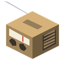
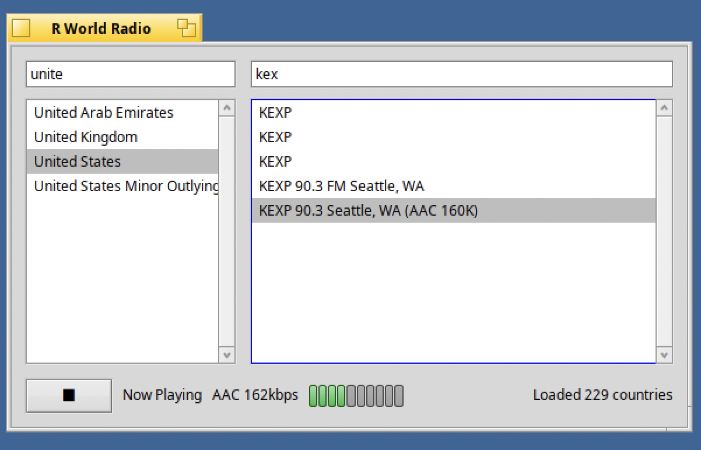

#  R World Radio for RenkuOS (HaikuOS)

English · [한국어](README.ko.md)



Native internet radio player for RenkuOS (HaikuOS), on x86_gcc2, x86_64 and
arm64.

## Installing with pkgman

Add the repository once, then install:

```sh
pkgman add-repo https://pkgman.rainygirl.com/$(getarch -p)
pkgman install rworldradio
```

On a 32-bit x86_gcc2 image the app is built against the x86 secondary
toolchain, so the package is named `rworldradio_x86`:

```sh
pkgman install rworldradio_x86
```

It appears in Deskbar's **Applications** menu as **RWorldRadio**.

If `pkgman add-repo` fails with `Operation not supported`, the network kit of
that image has no TLS; use `http://` instead of `https://`.

## Building from source

On Haiku, with the SDK that any standard install ships under
`/boot/system/develop/`:

```sh
make                 # -> objects.<arch>-<compiler>-release/rworldradio
./install.sh         # builds, then links it into Deskbar's Applications menu
```

`install.sh` links the station list from `../shared/data`, so keep this checkout
where it is. The first install may need a reboot before the menu entry shows up.

The arm64 native build has no makefile-engine; use `./build-arm64.sh` there.

## Keeping the station list current

```sh
python3 ../shared/tools/update_stations_db.py
```

Run this on a machine with internet access; the app itself never does it.

## License

MIT - see [LICENSE](LICENSE). The arm64 build includes minimp3 and FDK-AAC; see
[THIRD-PARTY-NOTICES.md](THIRD-PARTY-NOTICES.md).

## AI disclosure

Claude was used in the development of this program.
