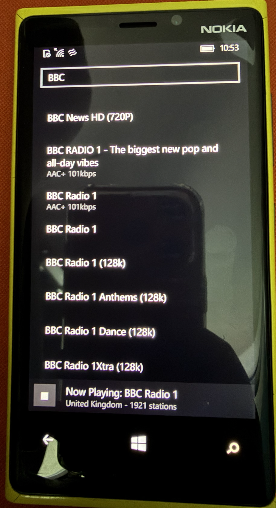

# R World Radio for Windows 10 Mobile

[English](README.md) · 한국어



Windows 10 Mobile(Windows Phone 10)용 인터넷 라디오 플레이어입니다. Nokia Lumia
920, Windows 10 Mobile 10586에서 테스트했습니다.

## 폰에 설치하기

미리 빌드해 서명한 패키지가 [`dist/`](dist)에 있으므로 빌드는 건너뛸 수 있습니다.

**빌드 10586 이상**이고 개발자 모드가 켜진 폰이 필요합니다:
**설정 → 업데이트 및 보안 → 개발자용 → 개발자 모드**.

1. 폰을 USB로 Windows PC에 연결합니다. `Windows phone`으로 나타납니다.
2. 다음 파일을 폰의 **다운로드** 폴더에 복사합니다.
   - `dist/RWorldRadio_1.0.0.0_ARM.cer`
   - `dist/RWorldRadio_1.0.0.0_ARM.appx`
   - `dist/Dependencies/`의 파일 세 개 (5단계가 실패할 때만 필요)
3. 폰에서 **파일 탐색기 → 다운로드**를 열고 먼저
   **`RWorldRadio_1.0.0.0_ARM.cer`**를 누릅니다. 인증서 설치를 확인합니다.
4. **`RWorldRadio_1.0.0.0_ARM.appx`**를 누릅니다. 설치되면 앱 목록에
   **R World Radio**로 나타납니다.
5. 프레임워크가 없다고 하면 `Dependencies`의 패키지 세 개를 먼저 누른 뒤 4단계를
   반복합니다. 대부분의 폰에는 이미 들어 있습니다.

3단계는 생략할 수 없습니다. 인증서 없이는 앱 설치가 실패합니다.

### 설치를 눌러도 아무 일이 없으면

패키지가 요구하는 OS가 폰보다 새로울 때 폰이 보이는 반응입니다. **설정 → 정보 →
추가 정보**에서 빌드 번호를 확인하세요. 이 패키지는 10586 이상이 필요합니다.

`WinAppDeployCmd`, USB를 통한 Device Portal, Visual Studio의 F5 배포는 모두
Microsoft가 더는 제공하지 않는 서비스가 필요합니다. 파일을 폰에 복사하는 것이
방법입니다. [AGENTS.md](AGENTS.md)를 참고하세요.

## 직접 빌드하기

**Windows** 머신이 필요합니다. ARM64를 포함해 Windows 11에서 됩니다.

**1. UWP 워크로드가 포함된 Visual Studio 2017 Build Tools를 설치합니다.** VS2019
이후는 Windows Mobile 지원을 뺐으므로 2017이 이걸 빌드할 수 있는 마지막
버전입니다. 디스크 약 17 GB가 필요합니다.

```
curl -L -o vs_buildtools.exe https://aka.ms/vs/15/release/vs_buildtools.exe
.\vs_buildtools.exe --quiet --norestart --wait ^
    --add Microsoft.VisualStudio.Workload.UniversalBuildTools --includeRecommended
```

`--log`는 붙이지 마세요. 부트스트래퍼가 새 설치 엔진으로 자신을 갱신한 뒤 그
옵션을 거부하고 아무것도 하지 않은 채 코드 87로 끝납니다.

**2. 서명 인증서를 만듭니다.** 주체가 매니페스트의 `Publisher`와 정확히 같아야
합니다. PowerShell에서:

```powershell
$cert = New-SelfSignedCertificate -Type Custom -Subject "CN=RWorldRadio" `
  -KeyUsage DigitalSignature -FriendlyName "RWorldRadio sideload" `
  -CertStoreLocation "Cert:\CurrentUser\My" `
  -TextExtension @("2.5.29.37={text}1.3.6.1.5.5.7.3.3", "2.5.29.19={text}")
$cert.Thumbprint
```

**3. 빌드하고 패키징합니다.** 저장소 전체를 체크아웃한 상태에서 이 디렉터리에서
실행합니다 (방송국 목록은 `..\shared\data`에서 읽습니다). `.pfx` 파일이 아니라
*지문(thumbprint)*으로 서명하세요. MSBuild의 키 파일 가져오기는 암호가 맞아도
`APPX0105`로 실패합니다.

```powershell
$msbuild = "${env:ProgramFiles(x86)}\Microsoft Visual Studio\2017\BuildTools\MSBuild\15.0\Bin\MSBuild.exe"
& $msbuild RWorldRadio.csproj /t:Restore /p:Configuration=Release /p:Platform=ARM
& $msbuild RWorldRadio.csproj /p:Configuration=Release /p:Platform=ARM `
    /p:PackageCertificateThumbprint=$($cert.Thumbprint)
```

`ARM`을 쓰세요. Windows 10 Mobile 기기는 모두 32비트 ARM이고 `x86`은 폰
에뮬레이터용으로만 빌드됩니다.

**4. 결과물을 모읍니다.** `AppPackages\RWorldRadio_1.0.0.0_ARM_Test\`에서:

```
RWorldRadio_1.0.0.0_ARM.appx     앱
RWorldRadio_1.0.0.0_ARM.cer      폰에 먼저 설치할 인증서
Dependencies\arm\*.appx          폰에 없을 때 설치할 프레임워크 패키지
```

그 뒤 위의 "폰에 설치하기"를 따릅니다.

빌드만이 아니라 코드를 고칠 생각이라면 먼저 [AGENTS.md](AGENTS.md)를 읽으세요.
실제로 시간을 잡아먹은 함정 열세 가지가 적혀 있고, 그중 여럿은 빌드 때가 아니라
기기에서만 드러납니다.

## 방송국 목록 최신 상태로 유지하기

목록은 빌드 시점에 고정됩니다. 갱신하려면
`python3 ../shared/tools/update_stations_db.py`를 실행하고 다시 빌드하세요.
`.csproj`의 파일 목록에 관해서는 [AGENTS.md](AGENTS.md)를 참고하세요.

## 라이선스

MIT. [LICENSE](LICENSE)를 참고하세요.

## AI 사용 고지

이 프로그램 개발에는 Claude가 활용되었습니다.
